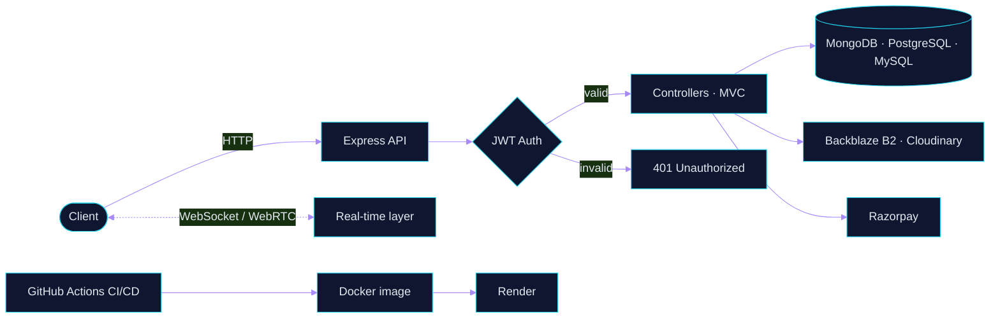

<div align="center">


**Building reliable APIs, real-time systems, and backend infrastructure.**

📍 Nashik, Maharashtra, India

<a href="https://swaraj-gaikwad.vercel.app"></a> <a href="https://linkedin.com/in/Gaikwad-Swaraj"></a> <a href="https://github.com/swaraj017"></a> <a href="https://leetcode.com/swarajgaikwad"></a>

 

</div>

---

## `01` — About

I'm a backend developer interested in building software that is reliable, maintainable, and ready to scale.

* **Backend:** Node.js, Express.js, REST APIs, authentication
* **Real-time systems:** WebSockets, WebRTC
* **Data:** MongoDB, MySQL, PostgreSQL
* **Infrastructure:** Docker, GitHub Actions, CI/CD
* **Open source:** Contributions to Postiz and Eclipse Theia

Currently building **Sentra**, a website health-monitoring platform to learn backend engineering, observability, and DevOps through hands-on implementation.

```yaml
now:
  building:      Sentra — website health monitoring
  learning:      [observability, DevOps, system design]
  contributing:  [Postiz, Eclipse Theia]
  practicing:    Data Structures & Algorithms on LeetCode
```

## `02` — Tech Stack

<div align="center">

**LANGUAGES**


**BACKEND & REAL-TIME**


**INFRASTRUCTURE & TOOLS**


**CLOUD & INTEGRATIONS**


**ENGINEERING FUNDAMENTALS**


</div>

## `03` — How I Build Backends



## `04` — Selected Projects

<table>
<tr>
<td width="50%" valign="top">

### Sentra

**Website health monitoring**

Building a monitoring service that checks website availability, response latency, HTTP status codes, and failures.

`Node.js` `Express` `Monitoring`

<a href="https://github.com/swaraj017/sentra">View repository →</a>

</td>
<td width="50%" valign="top">

### CloudShare

**Object storage & access control**

File storage platform integrating Backblaze B2 with APIs for uploads, access control, API keys, and CDN delivery.

`Node.js` `MongoDB` `Backblaze B2`

<a href="https://github.com/swaraj017/CloudShare">View repository →</a>

</td>
</tr>
<tr>
<td width="50%" valign="top">

### CodeVerse

**Real-time collaborative coding**

Collaborative development experience featuring WebRTC, Monaco Editor, and real-time communication.

`WebRTC` `JavaScript` `Real-time`

<a href="https://github.com/swaraj017/codeverse_v1">View repository →</a>

</td>
<td width="50%" valign="top">

### AI-Agent Recruiter

**Intelligent resume matching**

Academic project focused on resume ranking using transformer embeddings and automated recruitment workflows.

`AI` `Embeddings` `Recruitment`

<a href="https://github.com/swaraj017/AI_Agent_Recruitment_Sytem">View repository →</a>

</td>
</tr>
</table>

## `05` — Open Source

<div align="center">

<a href="https://github.com/gitroomhq/postiz-app"></a> <a href="https://github.com/eclipse-theia/theia">
</div>

Contributing fixes to real-world software projects and learning from established codebases, reviews, and maintainers.

## `06` — GitHub Activity

<div align="center">


<a href="https://leetcode.com/swarajgaikwad">

</a>

</div>

---

<div align="center">

**Designing APIs. Debugging systems. Shipping improvements.**

<sub>Always learning. Always building.</sub>


</div>
