 

   

---
## Tech Stack

<table>
<tr>
<td align="center" width="50%">

**LANGUAGES**

</td>
<td align="center" width="50%">

**BACKEND & REAL-TIME**

</td>
</tr>
<tr>
<td align="center" width="50%">

**INFRASTRUCTURE & TOOLS**

</td>
<td align="center" width="50%">

**CLOUD & INTEGRATIONS**

</td>
</tr>
<tr>
<td align="center" colspan="2">

**ENGINEERING FUNDAMENTALS**

</td>
</tr>
</table>

---

**<i>Now see what I build, what I contribute, and what I'm learning ↓</i>**

